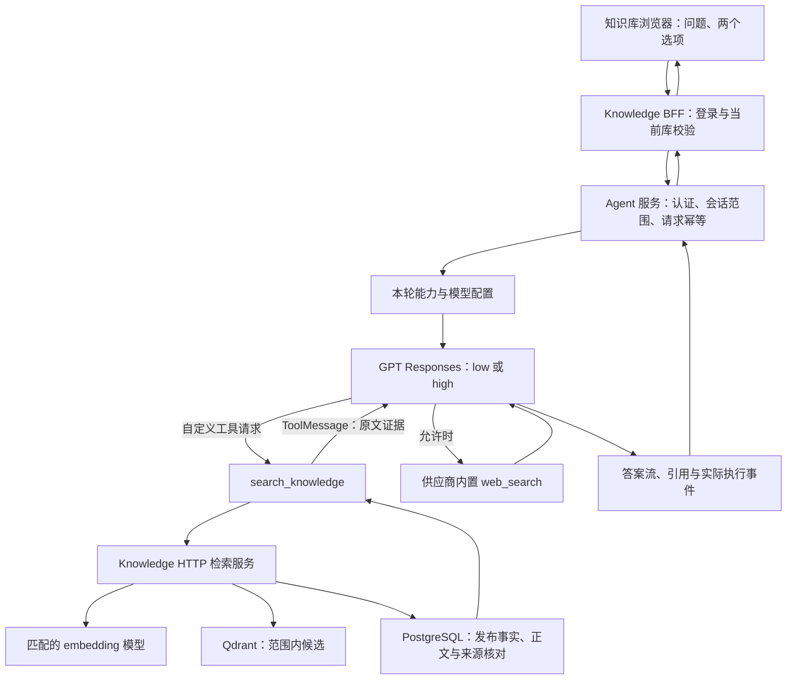

# 统一 Agent：知识检索、GPT 联网搜索与思考模式执行方案

日期：2026-10-28。实施更新：S1–S6 已接通，S7 本地功能回归与真实服务验证已执行，详见 [实施与验收记录](iterations/unified-agent-knowledge-web-reasoning.md)。供应商远端搜索硬次数限制仍是未通过的生产门槛，不表示已完成生产发布。

本方案面向后续接手本仓库的开发者或 Agent。目标是能直接按切片开始实施，明确输入输出、代码落点、失败行为及验收门槛。实际源码、锁定依赖和本轮测试优先于历史规划；开始每个切片前重新核对。

## 1. 本次确定的产品与技术决策

1. 产品是可接入业务项目的统一 Agent：普通聊天、知识问答、公开信息查询，后续扩展生成式 UI、业务查询和受控操作。名称中的 Support 不限制能力只能用于客服。
2. 保留 `apps/knowledge` 和 `apps/agent` 两个应用。知识系统负责资料、索引、检索与来源权限；Agent 系统负责模型、工具、对话、运行状态与预算。应用间走 HTTP，不跨应用导入源码或直接读对方业务表。
3. Agent 以受限工具调用为主要编排方式：注册 `search_knowledge`；普通聊天可以不调用工具；最新公开信息可以直接联网，无需先查知识库。
4. 网络搜索使用 GPT 供应商内置 `web_search`，不建设自定义搜索引擎、抓取器或第三方搜索工具。若当前接入端不支持，明确报告能力不可用，不静默换方案。
5. 思考模式使用模型原生 `reasoning.effort`。首版只有快速 `low` 和深度 `high`，不通过提示词、等待时间、扩大 Top K 或增加 Agent 步数模拟思考。
6. 当前对话模型配置为 `gpt-5.6-luna`、Responses API。本方案保留此模型，不因写方案升级或替换。知识嵌入模型与回答模型是独立配置，仍使用与已入库资料匹配的 embedding profile。
7. 知识库应用继续以库为入口，库内页面接通同一个 Agent；本阶段不增加与知识库同级的独立聊天入口。现有 Agent 调试页仍可用于通用能力验收。将来有统一对话入口需求时复用同一运行服务。
8. 不建设知识图谱、GraphRAG、子 Agent 平台、多角色管理、插件市场或通用工作流编辑器。混合检索和 rerank 由真实召回问题驱动，首版先建立 dense 检索基线。
9. 业务查询、生成式 UI 和业务操作只定义接入边界；具体项目、数据和动作尚未选定，不能虚构一个订单/退款系统作为正式业务交付。

## 2. 已有实现与未完成能力

### 2.1 当前代码事实

| 范围 | 已实现 | 本方案需要补齐 |
| --- | --- | --- |
| 知识管理 | 固定管理员登录、创建/列表、库内详情、上传、原文预览 | 本阶段不顺带开发重命名等无关管理能力 |
| 入库 | TXT/Markdown/DOCX 解析、分块、Ollama embedding、Qdrant 写入及逐项核对、ready 回执 | 有权限边界的业务检索接口 |
| embedding | `embedDocuments`、`embedQuery`、profile 标识、维度和数值校验 | 查询时正确复用 `embedQuery` 与入库配置 |
| Agent | `createAgent`、记忆工具、补资料 interrupt/resume、摘要、PII、模型/工具预算、有限模型重试 | 知识工具、原生搜索、按请求推理参数 |
| 会话 | checkpoint、独立可见历史、requestId 幂等、request_kind、unknown 核对、完成回执 | 知识范围、选项快照、引用及检索记录 |
| Agent HTTP | CopilotKit/AG-UI、本机身份、Host/Origin 限制 | 已认证的服务间接入与用户身份委托 |
| 知识库问答 | 草稿输入、禁用发送/历史按钮 | 真正发送、答案流、引用、历史与恢复 |
| UI | 补资料表单已接主 Agent | 不代表已具备任意业务卡片、页面动作或业务写操作 |

### 2.2 关键实际入口

- `apps/knowledge/components/KnowledgeDetail.tsx`：库内问答草稿及文件管理。
- `apps/knowledge/src/embeddings/client.ts`：`EmbeddingClient`、`embedQuery`、profile。
- `apps/knowledge/src/indexing/qdrant.ts`：collection 计算、Cosine 配置、写入和核对；目前没有业务 query 方法。
- `apps/knowledge/src/indexing/processor.ts`：point payload、generationId、ready 回执。
- `apps/knowledge/src/server/runtime.ts`、`src/service.ts`：知识登录、数据库和归属。
- `apps/agent/src/config/model.ts`：模型配置，支持 Responses；尚未设置原生推理选项。
- `apps/agent/src/agent/agent.ts`：工具装配、systemPrompt、中间件。
- `apps/agent/src/agent/run.ts`：会话执行、输入、checkpoint、事件。
- `apps/agent/src/ui/adapter.ts`：只接受本轮用户输入，不信任客户端历史/system/tools/state/身份。
- `apps/agent/src/server/runtime.ts`：共享初始化，当前固定开发身份；接入时必须解除“运行时绑定一个用户”的假设。
- `apps/agent/src/server/request.ts`：本机开发入口约束，不得直接删除来实现跨应用访问。
- `apps/agent/src/conversations/{contracts,service,execution,receipt}.ts`：请求状态、幂等和恢复证据。
- `apps/agent/app/api/conversation/route.ts`：只读恢复；保持不执行模型、检索和业务工具。

### 2.3 最近验证记录的含义

`docs/iterations/knowledge-qdrant-indexing.md` 记录 33 项本地、18 项 PostgreSQL、5 项真实 Qdrant 测试，以及两份真实文件产生 30 个 1024 维 point 的入库链路。它证明此前入库验收，不证明 RAG 回答、联网、思考切换或业务集成完成。本轮只写文档，不重跑这些测试，不把历史记录报告成新测试结果。

锁定依赖当前为：`langchain 1.5.18`、`@langchain/core 1.2.20`、`@langchain/langgraph 1.5.2`、`@langchain/openai 1.6.3`、CopilotKit `1.79.1`、Next `16.4.3`。实施前核对 lockfile；不照搬最新网页示例中的版本和构造参数。

## 3. 官方机制、备选方案与取舍

官方资料核对日期统一为 2026-10-28。以下仅说明机制与支持，不主张行业占比或未经测量的性能优势。

| 决策 | 当前选择 | 备选及何时重评 |
| --- | --- | --- |
| 检索编排 | Agent 调 `search_knowledge`，必要行为由程序约束 | 固定先检索适合明确只允许资料回答的流程；同一检索服务可直接调用，不重复实现 |
| 外网搜索 | GPT Responses 内置 `web_search` | 当前不做第三方搜索；仅当供应商能力或接入要求改变才重评 |
| 推理 | 原生 effort：quick→low、deep→high | 多供应商适配、更多档位、pro mode 暂不装配 |
| 传递证据 | 真正工具调用的结果作为 `ToolMessage.content` | 固定检索可放明确分隔的上下文；不构造无对应 tool_call_id 的工具消息 |
| 会话存储 | 扩展原会话/请求与 checkpoint | 不在知识应用另建一套 Agent 或聊天事实库 |
| 查询向量 | 请求内存使用 | 重复请求成本实测明显时再考虑有配置隔离的缓存 |
| 检索质量 | 有效范围内 dense 基线 | 中文型号、精确编号等漏检经评估后再加关键词/融合/rerank |

一手来源：

- [GPT-5.6 Luna 能力](https://developers.openai.com/api/docs/models/gpt-5.6-luna)：官方列出 effort `none/low/medium/high/xhigh/max`，默认 medium；Responses 支持 Web search、function calling、streaming。
- [OpenAI reasoning](https://developers.openai.com/api/docs/guides/reasoning)：effort、推理摘要和工具循环的 reasoning item 保留要求。不能把其他模型专属 configuration_update 机制直接套用到当前模型。
- [OpenAI web search](https://developers.openai.com/api/docs/guides/tools-web-search)：内置搜索、可选/强制调用、搜索事件与 URL 引用；前端保留可点击来源。
- [LangChain tools](https://docs.langchain.com/oss/javascript/langchain/tools)：工具参数、运行上下文、结果消息。
- [LangChain retrieval](https://docs.langchain.com/oss/javascript/deepagents/retrieval)：固定与 Agentic/组合检索。
- [Qdrant Query 1.19.x](https://api.qdrant.tech/v-1-19-x/api-reference/search/query-points)、[过滤](https://qdrant.tech/documentation/concepts/filtering/)：向量 query、payload 条件；与此前验收记录中的 Qdrant 1.19.1 对齐。

官方支持不代表当前代理地址、凭据或部署已支持。启用前必须通过真实能力探测，不能只检查模型名称。

## 4. 最终调用链与职责



浏览器不连接 Qdrant/Ollama，不持有服务凭据。Agent 不直接读知识数据库。Knowledge 不新建模型对话循环。服务日志不输出凭据、完整 cookie 或推理加密字段。

模型工具集合不是授权源：即使模型构造了其他库 ID、用户 ID 或操作参数，服务端仍拒绝越权。

## 5. 运行契约与输入选项

### 5.1 首版请求结构

```ts
type RunOptions = {
  webSearch: boolean;                 // 缺省 false
  thinkingMode: "quick" | "deep";     // 缺省 quick
};

type PublicRunInput = {
  conversationId: string;
  requestId: string;
  message: string;                    // 1..12000 字符，与现有上限一致
  options?: RunOptions;
};
```

知识库 ID 放在 BFF 路由中，由服务端构造范围；不允许浏览器在这份 body 中传任意 scope、tool、systemPrompt、凭据、model URL 或历史。首版模型固定，不提供 modelProfileId 选择器。

归一化默认选项后再计算 payload hash。相同 requestId + 相同归一化语义重放已有结果；相同 ID + 不同问题/选项/知识范围返回 409。旧客户端未传选项得到明确默认值；旧请求记录没有选项时按 legacy 兼容，不重算旧 hash 或触发重执行。

请求体大小与字符上限分别校验：run/检索路由首版 JSON body 上限 64 KiB，超出 413；中文 4000/12000 字符不等于同样数量字节。现有 Knowledge `readJson` 上限只有 8192 字节，不能不加调整就复用到新接口。为新路由增加显式可配置上限的受限 reader，旧登录/创建接口保持原限制。服务签名按收到的原始 body 字节计算并验证，再解析为严格 schema；同一份原始字节不得因重新 JSON 序列化而变更签名含义。

### 5.2 服务端本轮上下文

```ts
type EffectiveRunConfig = {
  version: 1;
  model: string;
  apiMode: "responses";
  reasoningEffort: "low" | "high";
  webSearchEnabled: boolean;
  applicationId: string;
  scopeRevision: string;
  knowledgeBaseIds: string[];          // 首版库内仅一个；可为空用于现有通用调试入口
  now: string;                         // ISO 时间
  timezone: string;                    // 首版可信应用默认 Asia/Shanghai
  policyVersion: string;
};
```

把选项和最终采用配置记录到请求；身份沿用 SupportContext 但只由已认证服务构造。`runtime.context` 供工具/中间件读取，不会自动让模型看到；当前时间、范围说明等仅按需要投影为可信指令。

同一逻辑请求（包含等待补资料后的 resume）固定其语义选项。恢复时重新认证并复查权限，但不接受表单恢复请求偷偷改变 webSearch/effort。修改开关只影响下一条新消息，执行中禁改或明确显示“下轮生效”。

### 5.3 模型配置隔离

`server/runtime.ts` 共享连接池、checkpointer、工具和工厂，不共享可变的“当前用户/当前 effort/当前联网开关”。不得修改全局 ChatOpenAI 实例字段来切换请求。

首选在现有 `wrapModelCall` 机制中依据可信本轮上下文选用配置不可变的模型变体，或按规范化配置缓存不可变实例。工具绑定仍由 createAgent 统一完成；先用锁定 SDK 验证原生工具与本地工具能共存，避免重复 bind 丢失工具。摘要模型使用固定独立配置，不受输入框开关意外驱动联网或高推理。

## 6. 跨应用认证、授权和会话范围

### 6.1 分阶段入口

保留现有 3100 本机调试路由限制；新增明确的内部服务路由供 Knowledge BFF 调用。运行核心共享，但认证入口不同。当前开发身份不能当作 knowledge 登录用户，也不能用放开 CORS 或删除 Host 校验代替认证。

首版只接入已登录知识管理员，不建设通用用户体系。后续业务系统接入时需另做它自己的已认证主体到应用/知识权限的映射，不把任意业务 userId 当作 knowledge_users.id。

### 6.2 首版服务认证协议

采用两个方向独立配置的服务密钥和 HMAC-SHA256 请求签名，使用成熟 Node crypto，不自创加密算法：

- Knowledge BFF → Agent：调用方 `knowledge-web`，凭据只在两个服务端。
- Agent → Knowledge：调用方 `support-agent`，使用另一份凭据。
- 密钥通过环境提供；公开示例只写变量名，例如 `AGENT_KNOWLEDGE_WEB_SECRET`、`KNOWLEDGE_SUPPORT_AGENT_SECRET`；不写入文档、浏览器或数据库正文。

签名载荷为明确序列化的版本、caller、audience、HTTP method、规范化 path、body SHA-256、issuedAt、expiresAt、nonce；上下文包含在 body hash 内。最长有效 60 秒，允许时钟偏差 30 秒；固定长度常量时间比较。nonce 首次使用时原子登记在接收方 public 表，唯一键 `(caller, nonce)`，过期清理；重发 HTTP 请求使用新 nonce，业务 requestId 保持不变。

body 内的委托主体首版携带 knowledge 用户 ID 和 session 记录摘要（现有 token_hash），不传明文 cookie。Knowledge BFF 从真实 cookie 查得，浏览器不能指定。Agent 到 Knowledge 原样携带委托事实；Knowledge 用自己的数据库复查 session 有效、用户 active、session 用户匹配、库 owner 匹配。摘要不是单独的授权令牌，只有签名服务请求才可使用。该委托摘要仅运行时使用，不写 checkpoint、模型上下文、消息、追踪或结果。

Agent 验证签名后还需调用 Knowledge 的范围解析接口，不能仅凭签名信任浏览器选中的库；每次新请求和恢复先核对，长轮次在检索、后续模型调用和最终发布前检查有效性。登出/过期/撤权阻止继续；已经流给用户的文本无法撤回，记录这个实际边界。

内部接口只接受服务签名，不接受浏览器 cookie 单独调用；BFF 对浏览器的 POST 仍执行现有登录和同源校验。错误不泄漏其他用户的库/文档存在性。

### 6.3 应用知识授权

知识系统增加最小 `knowledge_application_grants`：`application_id`、`knowledge_base_id`、`active`、`revision`、时间；组合唯一。首版应用 ID 固定为配置中的知识库问答应用；创建 grant 通过受控初始化/服务端命令，不建设管理 UI，不默认所有应用拥有所有库。

权限范围 = 应用有效 grant ∩ 当前主体可访问库 ∩ 本次页面选择。当前管理员访问仍按 owner 校验。公共库跨应用共享需要显式 grant；缺 grant 不退为全库搜索。为旧库初始化授权要列出受控目标，不能对任意未来应用自动授权。

### 6.4 会话绑定

增加 Agent 所有的会话范围记录，至少保存 `scope`、`thread_id`、applicationId、规范排序的库 ID、scopeRevision、createdAt。记录身份范围；不是独立聊天实现。

- 会话首次创建由服务端绑定；以后范围不匹配返回 409，换库新建/打开该库原会话。
- checkpoint key 继续使用现有身份隔离，再加已绑定会话范围核对；不从客户端 checkpoint/state 推导权限。
- 请求恢复重新核对范围及来源。授权修订变化或已用来源失效时，首版拒绝继续旧上下文并要求新会话；不要在未验证的情况下自动清洗摘要后续跑。
- 旧无范围会话只能留在原开发入口；不能迁移成知识授权会话。即使历史已有 answer，也不为它编造新引用。

## 7. 知识检索：逐步执行规范

### 7.1 API 与服务接口

浏览器检索调试接口：`POST /api/knowledge-bases/[id]/search`，登录+同源，body `{ question }`；仅返回该用户当前库证据。用于 S1 验收，不需要先建聊天会话。

内部接口：`POST /api/internal/retrieval/search`，服务签名，携带 application、已认证委托、conversation/request/toolCall 标识、期望范围修订和 query。HTTP 层分别认证，再调用相同 RetrievalService；不复制两条检索实现。

内部范围解析：`POST /api/internal/retrieval/scope`，检查 session/owner/grants，返回服务器生成的范围修订及可用资料概要；不返回凭据或向量。

内部引用核对与详情：分别提供 `/api/internal/retrieval/validate` 和受控 evidence 读取接口；路径可在对应切片按既有 Next 目录调整，但必须在实现记录写最终契约。

### 7.2 检索步骤（按此顺序实现）

1. 校验输入 query：字符串、trim 非空、首版最多 4000 字符；模型工具 query 与页面原问题分开记录，避免伪装用户原话。
2. 确认登录/服务认证、应用 grant、主体归属和本次范围；取消信号从 HTTP 一直向下传递。
3. 查询 PostgreSQL：仅允许 `processing_status='ready'` 且存在一致的 `embedding_profile/index_target/index_receipt` 的文档。读取文档 ID、内容 SHA、collection、generationId 和 profile。未来存在显式发布/撤回字段时，必须一起校验。
4. 没有 ready 资料：返回明确 `no_ready_documents`，不调用 embedding、不创建 collection。
5. 检查 profile：首版只支持与当前服务 embedding 配置完全匹配的一套 profile；混用模型/维度/前缀/版本或索引端点变化返回配置错误，不跳过不兼容文档伪装完整结果。
6. 调现有 `embedQuery(query, signal)`；使用 profile 中匹配的 queryPrefix。验证向量数量、维度、有限数值、非全零；问题向量仅本轮内存使用，不存 PostgreSQL/Qdrant。
7. 从可信 receipt 确定 collection；确认它与当前 Qdrant endpoint/profile 对应。查询路径不调用 ensureCollection、upsert 或写 payload index；预期 collection 不存在是索引故障，不是空结果。
8. 构建 filter：knowledge_base_id、embedding_profile_id，及 `(document_id, generation_id)` 允许组合的 OR。禁止“先全库查 Top K 再过滤”，也禁止独立拼错位 document/generation 列表。首版最多支持一个库、200 份 ready 文档；超出返回明确范围过大错误，不能静默截断。大范围查询策略以后单独测量和优化。
9. 调 `POST /collections/{collection}/points/query`，query=问题向量、with_vector=false，payload 只取核对所需字段。候选数初始 10，Cosine 分数越大越相近。
10. 批量回 PostgreSQL 核对候选片段：文档/库/profile/generation/内容指纹/ready/权限仍有效；正文从 PostgreSQL 读取。记录候选与剔除原因，损坏/不一致不得当成正常缺知识。
11. 对内容完全重复的证据去重；稳定排序（score 降序，相同分数以 chunk ID 定序）。首版不使用模型重排，不提前宣称分数阈值代表有答案。
12. 控制证据预算：初始最多 6 条、总正文 12000 字符；保留完整片段，不在条件句中截断，不默默省略例外。超过预算跳过并标记 budgetLimited；单片段过大导致无可用证据返回 `evidence_budget_exceeded`。这些是初始工程限制，需用真实问题集调整，不是模型 token 等价换算。
13. 候选核对后不足时最多补查一次：同范围候选上限 20、按 ID 去重；不放宽权限。若有来源变化，返回 scope_changed 或索引不一致，不把冲突藏成空结果。
14. 在检索审计记录保存配置、候选 ID/分数/核对结果、最终证据、阶段耗时。保存成功后才把成功证据作为可追溯结果交给上游；记录失败不得声称具备完整审计。
15. 返回证据；没有候选与上游/索引故障使用不同结果。Embedding/Qdrant 超时不转换成 no_match。

### 7.3 证据契约

```ts
type KnowledgeEvidence = {
  evidenceId: string;                 // 服务端生成，不由模型构造
  knowledgeBaseId: string;
  documentId: string;
  documentName: string;
  chunkId: string;
  sourceSha256: string;
  generationId: string;
  embeddingProfileId: string;
  headingPath: string[];
  sectionIndex: number;
  startOffset: number;
  endOffset: number;
  text: string;
  contentSha256: string;
  score: number;                      // 排名依据，不是答案正确率
};

type RetrievalResult = {
  retrievalId: string;
  status: "ok" | "no_match" | "no_ready_documents";
  evidence: KnowledgeEvidence[];
  budgetLimited: boolean;
  scopeRevision: string;
};
```

故障走类型化错误，不塞进成功 evidence。页码只在解析器实际提供可靠页码时新增，不从 sectionIndex 推算。首版复用当前 documentId+sourceSha+generation，不谎称已实现完整 DocumentVersion 替换发布系统。

## 8. Agent 知识工具与模型消息

### 8.1 工具参数

`search_knowledge` 首版 schema 仅 `{ query: string }`。用户身份、应用、知识库范围、topK、collection、URL、profile 和访问凭据均从可信 runtime 获取，不开放给模型。

工具说明要求：查询当前允许范围的内部资料；查询内部制度/产品规则时使用；无结果要如实说明；公开最新信息不强制先用它。多轮追问由模型结合当前合法历史生成完整 query，保留原始问题与工具 query 的区别；不先新增独立“问题改写 Agent”。

### 8.2 返回与引用

检索工具返回一个结构化结果，框架包装为匹配 tool_call_id 的 ToolMessage。模型可见 content 包含稳定证据编号、文档名、章节、正文、来源身份；不返回向量、服务凭据和调试堆栈。完整分数/候选追踪可留审计，不要求模型依分数判断事实真伪。

真实工具结果示意：

```json
{
  "status": "ok",
  "retrievalId": "服务端检索编号",
  "evidence": [{
    "citationId": "K:稳定证据编号",
    "documentName": "差旅报销制度",
    "headingPath": ["报销时限"],
    "text": "员工应在出差结束后 30 日内提交报销申请。"
  }]
}
```

SystemMessage/systemPrompt 放身份、能力、引用和来源规则；HumanMessage 保留真实问题；外部资料属于证据，不升格成系统指令。runtime.context/state/artifact 本身不会自动成为模型输入，必须在工具 content 或明确的请求上下文中实际传递。

系统提示需删除当前“没有接入知识库”的固定句，改为按本轮真实能力说明；不宣称未接的业务工具。提示要求不能替代权限或来源核对。

### 8.3 模型选择与程序约束

普通聊天允许零工具；问内部事实应检索；问最新公开事实且允许联网应搜索；内部+外部组合允许两类来源。工具漏调用、错选、无依据引用纳入真实模型评估。

首版不声称仅提示词即可强制业务契约：需要“必须有内部依据”的严格回答流程，最终输出校验时要求存在已核对知识证据；不满足就不给出受支持的内部结论。首轮可直接返回明确的依据不足结果。若后续需自动纠正，作为有次数预算的新策略实现；不在后台无限重试。

## 9. GPT 原生思考和联网

### 9.1 思考配置

`quick → reasoning.effort='low'`，`deep → 'high'`。使用当前 ChatOpenAI 的 `reasoning` 字段；本地旧 `reasoningEffort` 已标记 deprecated。首版不调整 temperature、不引入 pro mode，不将 deep 等同于更多搜索次数或更高权限。

请求内选项应用到本轮所有主 Agent 模型调用；摘要保持独立固定配置。使用不可变模型实例/调用包装，测试并发 A=quick、B=deep 不串配置。当前模型切换 effort 通过每轮请求参数验证，不照搬 GPT-6 专属 configuration_update。

推理摘要可选：`reasoning.summary='auto'` 需先验证模型和真实端点支持。首个思考切片仅保证 effort 切换；摘要 UI 是后续增量，不作为思考能力是否开启的判断标准。不索取、伪造或把完整内部推理写进答案。

### 9.2 联网配置

联网关：本轮不绑定内置 web_search；后端仍防止其他路径新增搜索。开关含义是禁止新网络搜索，不表示抹去已经展示过的历史网络事实；历史引用仍标注它原来的查询时间。

联网开：在同一次 Responses 模型请求中提供供应商原生 `{ type:'web_search' }`，与 search_knowledge 等本地 function tools 共存。默认 auto 按需搜索，公开最新事实按策略要求核实；不采取“只有库里没有答案才允许搜索”。

不另外发一个脱离现有 Agent 的 OpenAI 请求来充当联网回答，不维护第二套消息历史。供应商内置搜索由远端执行，不伪装成本地工具执行成功，也不假设本地 ToolMessage/预算能自动覆盖。

### 9.3 原生请求示意

```ts
{
  model: "gpt-5.6-luna",
  reasoning: { effort: "high" },
  tools: [
    /* createAgent 装配的 search_knowledge 等 function 定义 */
    { type: "web_search" }
  ],
  tool_choice: "auto",
  input: /* 由框架从服务端历史和本轮输入转换 */
}
```

这是协议形状，不是可以绕开 Agent 直接粘贴的新调用链。开发时检查锁定 `@langchain/openai` 的 bindTools/converter/streaming 行为；先写真实能力探测，再接 UI。若支持不完整，优先做最小适配或有证据的依赖调整，不放弃既有执行机制。

### 9.4 搜索结果和时间

解析供应商 `web_search_call`、完成/失败事件、文本块与 url_citation annotations；不要只保留 output_text 而丢掉网页引用。只把供应商实际返回的事件展示为“正在联网搜索”。

本轮可信时区和当前时间供模型理解昨天/最近；要求核对发布时间与事件日期，优先官方原始来源。不能把网页出现某关键词等同于昨天发布更新，也不能将外网制度作为本公司制度的替代依据。

公开搜索时不把内部证据直接拼成搜索词；用户问题可能含内部信息，服务端输入策略与模型工具说明需限制外传。内置搜索发生在供应商内部，本应用不能假称逐次拦截了所有远端搜索参数；搜索词可见性、域名约束和数据策略以真实 API 能力为准。

### 9.5 预算与超时

保留现有本地工具每轮 4、会话 40 的默认预算和原模型预算；不要为演示深度模式无限扩大。知识工具调用计入本地工具预算，补资料和记忆仍共享已有规则。

供应商搜索增加独立统计：每个 provider response 的搜索调用、耗时、返回 usage 与 responseId 关联本轮 request/run。实际支持的远端工具调用上限参数，以对应 API Reference 与锁定 SDK 核对后配置，并以故障注入验证；本地接到结果后计数只能检测已发生消耗，不能宣称是执行前限额。若要求严格限额而端点不能提供，应明确能力限制并阻止未验收部署，不把提示词当硬限制。

初始检索总截止 45 秒（embedding、Qdrant 单次不得超剩余预算），主模型单次目标 60 秒、整轮目标 180 秒。当前路由 maxDuration=90，深度/搜索接入必须一起核对 Next、代理和运行宿主的真实限制；只有该切片需要时再调整，对不支持的宿主明确拒绝/报告超时，不写一个无效数字假装已解决。延迟数值是初始配置，真实模型实验后记录。

取消向下传递；已发生的供应商调用可能已计费，不能宣称撤销。已有主模型有限重试机制维持单一所有者；已输出文本不重试，含搜索的模糊故障不得默认重复搜索。重复已完成请求只回放持久结果，不再次联网。

## 10. 数据持久化与引用恢复

### 10.1 原则

问题原文、请求选项、有效配置、会话范围、检索证据关联、最终答案和引用需要可恢复；问题向量无需持久化。checkpoint 是执行状态，不作为独立用户历史事实的替代；不要从任意旧 checkpoint 推断当前请求完成。

### 10.2 建议数据库变更

表名及字段在对应切片的 SQL 最终落定，但职责和约束不可省略。各应用只迁移自己的表，均在当前 public schema，不新建数据库或 practice schema。

| 所属 | 变更 | 最小内容 |
| --- | --- | --- |
| Knowledge | 新增 application grants | 应用、库、active、revision，组合唯一 |
| 两端分别所有 | 服务 nonce 表 | caller、nonce、expiresAt，原子唯一；只用于服务重放保护 |
| Knowledge | retrieval records | retrievalId、主体不含 session 凭据、应用、库/范围修订、query、profile、策略版本、状态、候选与最终证据、阶段耗时、失败码 |
| Agent | conversation scope 表 | 身份 scope+thread 唯一、应用、库集合、范围修订 |
| Agent | 扩展 conversation requests | normalized options、effective config、结果协议版本；旧行默认兼容，不覆盖原 hash |
| Agent | run evidence 表 | scope/thread/request/run、citationId、kind、来源快照、检索关联、内容/来源指纹；唯一引用键 |
| Agent | 扩展 result/receipt | version、answer、引用、实际配置、工具/搜索摘要、可见 UI 结果；与请求 ID 和 runId 一致 |

初始 retrieval records 可用受限 JSONB 保存候选和证据列表，不另造每层日志表。正文快照只保存被选证据，明确保留目的；不记录向量、cookie、服务签名、完整环境变量或推理加密字段。错误日志脱敏，数据保留/清理采用当前应用配置，不能因追踪永久保留所有私有原文。

### 10.3 完成与恢复的原子边界

先持久化本轮证据/引用清单，再让完成回执包含对应清单指纹或可恢复的完整引用；最后调用现有 conversation.finish 原子保存请求结果与 assistant 可见消息。checkpoint 完成与 SQL 档案提交不处于同一事务，崩溃后按 request_kind + 当前 requestId/runId 的匹配回执和证据清单核对。

缺引用清单、回执不匹配、状态不确定时不能报告“完整完成”；保留 unknown/受限失败，禁止自动重跑。只读 GET 可以核对持久事实，但不能重新执行模型、embedding、搜索、工具或产生新的引用。复用现有请求修复机制，不再创建并行恢复通道。

### 10.4 引用类别

Knowledge 引用保存 knowledgeBase/document/chunk/sourceSha/generation/profile/定位/检索 ID；Web 引用保存供应商 annotation、URL、标题、抓取/搜索时间及 provider response/call 关联。所有链接只接受受支持协议，网页按 https/http 规则处理，不执行 javascript/data URL。

知识引用正文展开经 Knowledge 服务重新鉴权；Web 引用来自实际供应商结果，不信任模型随手生成的 URL 就当成已搜索来源。刷新返回持久引用，无需重新搜索。旧引用失效显示明确状态；授权撤回后不通过历史引用 API 泄漏正文。

语法校验（引用 ID 存在）不代表语义校验（原文支持结论）。两者分开评估。首版流式答案是临时显示，最终校验失败时必须标记为未通过，不能把已显示文本宣称撤回。若未来要求任何非法引用都不可见，需要改为缓冲校验后发布，作为明确产品取舍。

## 11. HTTP、事件与前端

### 11.1 BFF 路由建议

| 路由 | 行为 |
| --- | --- |
| `POST /api/knowledge-bases/[id]/search` | 管理员调试检索，S1 可独立验收 |
| `POST /api/knowledge-bases/[id]/conversations` | 认证后创建/绑定当前库会话 |
| `POST /api/knowledge-bases/[id]/conversations/[thread]/run` | 校验本轮问题/选项，签名转发 Agent，透传 AG-UI 流 |
| `GET .../[thread]` | 读取可见历史、状态和引用，服务端范围复核 |
| `POST .../[thread]/information` | 同一契约转发表单恢复，不重新发原问题 |
| `GET .../[thread]/citations/[citationId]` | 当前权限下读取引用详情 |

Agent 内部路由使用 `/api/internal/...`，同运行核心但独立服务认证；不复用会被 Host 限制拒绝的公开开发路由，不靠伪造 Origin/Host 转发。源文件的最终 API 命名在实施记录和调用方一并修改，不能只做服务不接消费方。

### 11.2 事件

复用 AG-UI RUN_STARTED/TEXT_MESSAGE_*/RUN_ERROR/RUN_FINISHED 与现有补资料 TOOL_CALL 事件。增加有版本的应用事件，不向浏览器透传整份供应商 JSON：

```ts
type SupportRunMetadata = {
  version: 1;
  logicalRunId: string;
  requestId: string;
  effectiveOptions: { thinkingMode: "quick" | "deep"; webSearch: boolean };
};
// CUSTOM support.run_metadata
// CUSTOM support.retrieval：开始/结束/失败及检索 ID，无私有调试堆栈
// CUSTOM support.web_search：来自真实 provider 调用的状态
// CUSTOM support.citations：校验后的引用集合及是否最终
// CUSTOM support.reasoning_summary：可选，供应商实际支持后再加入
```

先定义事件 schema，再改 run.ts 的事件类型、SDK 适配和 UI。当前 run.ts/adapter 主要转发文本，不能假设开启原生工具就自动有完整引用事件。reasoning/tool JSON 不得混入正常文本流。多文本块、并行本地工具、内置搜索调用和分段引用的关联要有测试。

### 11.3 UI 交付

输入框增加联网开关（默认关）与快速/深度（默认快速），旁边显示当前库。能力未通过验证时置为不可用并说明，不能可点但后台忽略。偏好可保存在客户端用于下一轮，但服务端请求快照是执行事实。

接通发送、新会话、同库历史、停止、来源展开和刷新恢复；保留现有运行中/等待/失败/unknown 的禁止新发规则。流中断不自动 resend。提示“正在联网搜索”只能由真实搜索事件驱动。

知识库 ready 文档为空时，资料问答说明没有可用资料；允许联网时仍可回答公开问题，不能把空库等同于整个 Agent 不可用。联网关闭的最新事件问题明确无法实时核实，不编造最新结论。

错误详情与服务配置只出现在开发诊断面板或日志，不进入普通产品主流程。

## 12. 未来业务和生成式 UI 的接入边界

本节是扩展契约，非当前一次实施任务。

- 业务工具：先一个真实只读能力，由业务服务认证用户并检查资源归属，返回版本化结构。知识片段不承担订单状态、余额或业务执行结果。
- 生成式 UI：受限组件类型+props Schema；服务端校验后发 UI 事件，前端只渲染注册组件，不执行模型生成的任意 JS/HTML。结果要能随会话恢复，模型声称“已经展示”不算展示证据。
- 页面动作：跳转/填写草稿属于宿主桥接事件，明确动作 ID、允许目标和确认结果；与服务端业务工具区分。
- 写操作：模型提出参数，服务端重新计算规则和权限；必要时通过现有持久中断机制确认，再执行有幂等键的业务命令。未知结果按业务查询核对，不自动重发。
- 业务主动推送：另行定义 Webhook/事件身份、幂等与乱序，不能混成模型工具调用。
- 先确定真实项目及操作契约再实施，不根据本文件自选退款/支付/删除等具体动作。

## 13. 分切片执行清单

本轮只产出方案。后续每轮只执行一个切片；开始时说明问题、输入输出/失败、机制、备选和取舍。表中每个切片应形成独立可运行验收结果；出现新事实需更新方案而不是硬套。

| 切片 | 交付 | 依赖 | 完成门槛 |
| --- | --- | --- | --- |
| S1 | Knowledge 认证用户检索服务、调试 HTTP、证据契约和最小追踪 | 当前入库 | 真问题→真实 embedding→真实 Qdrant→合法原文；无越权、失败不冒充无匹配 |
| S2 | 服务签名、委托身份、应用 grant、范围解析和会话绑定 | S1 | BFF→Agent→Knowledge 正确识别同一已登录用户；伪造/重放/过期/登出拒绝；A/B 隔离 |
| S3 | `search_knowledge` 工具接原 Agent、内部运行接口、引用持久化 | S2 | 真实模型选择工具→合法证据→带引用回答；完成回执、重放/unknown 不回归 |
| S4 | 库内问答真实 UI 闭环 | S3 | 发送/流/来源/历史/停止/刷新/补资料恢复可用；无伪历史 |
| S5 | 原生 quick/deep 选项、请求幂等配置快照、隔离模型配置 | S4 | 本地请求参数证据+真实 GPT 两档调用；并发不串选项；resume 不变更原选项 |
| S6 | GPT 内置联网、原生事件/引用、独立预算观测、UI 开关 | S5 | 真实联网回答公开时效问题，关闭不搜索，引用/刷新/故障与预算通过 |
| S7 | 组合评估、权限/来源变更恢复、发布验收记录 | S6 | 固定评估集、两类引用、失败/断流/重放、性能和消耗记录完整 |
| S8（另定业务） | 第一个真实业务只读工具及 UI | 真实项目契约 | 明确身份/数据源/组件与真实业务验收，未选项保持待定义 |
| S9（另定业务） | 第一项受控写操作 | S8+业务写契约 | 确认/幂等/执行结果/未知核对真实闭环 |

S1 对应原 K8；S2 对应 K10 的最小接入与授权；S3 对应 K11；S4 对应 K12；S7 扩展 K13。K9 文档替换/删除仍是独立生命周期切片，不因本方案跳过；S7 至少通过测试记录撤权/失效，正式删除 UI 与完整版本发布不能冒充已完成。

S5/S6 不依赖另建统一聊天入口。需要提前做小型只读 API 能力探测时可以作为各切片前置验证，但不把探测脚本当产品交付。

### 13.1 S1 的可直接执行任务

1. 新增 `apps/knowledge/src/retrieval/contracts.ts`：Zod 输入/输出、错误码、证据结构。
2. 新增 `src/retrieval/service.ts`：依赖注入 pool、EmbeddingClient、Qdrant 查询适配，执行第 7 节全部步骤。
3. 在 `src/indexing/qdrant.ts` 扩展只读 query 方法，或抽出同目录只读适配；不复制网络超时/脱敏逻辑，不将查询错误映射成写入 unknown。
4. 新增 `src/retrieval/repository.ts` 或现有合适仓储：ready 清单、候选批量核对、审计保存；SQL 参数化。
5. 在 knowledge 下一空闲 SQL 编号增加检索记录，初始化/状态脚本同时更新。当前最新为 007，实施前检查是否仍为下一号 008。
6. server runtime 增加检索服务工厂，复用连接池，不在模块加载/构建时连接模型和数据库。
7. 新增 `/api/knowledge-bases/[id]/search/route.ts`；未登录 401、无权库 404、无效输入 400/413、配置冲突 409、依赖失败 503/超时 504，返回稳定 code。
8. 增加必要的确定性与真实 PostgreSQL/Qdrant 测试，再用真实 embedding+现有验收资料执行问题集。
9. 写 `docs/iterations/knowledge-retrieval.md`、更新学习覆盖，说明哪些结果为真实、哪些为模拟。
10. 走读 HTTP→权限→profile→embedQuery→query→PostgreSQL→evidence 调用链并给出运行命令。S1 不接 Agent、联网和思考 UI。

### 13.2 S2—S6 主要代码落点

- Knowledge：新增 `src/integrations/`（服务签名/授权）、internal retrieval routes、问答 BFF；只将应用真正需要的模块放这里。
- Agent：新增 `src/knowledge/{client,tool,contracts}.ts`；HTTP client 不依赖 Knowledge 源码；协议用各自 Zod 验证，不提前抽共享包。
- Agent：新增 `src/agent/run-options.ts` 与原生能力适配/中间件，修改 model.ts、run.ts、agent.ts、server/runtime.ts；不创建第二个 runSupportAgent。
- Agent：扩展 support-context/会话范围，不把浏览器身份纳入可信字段；区分开发入口和已认证服务入口。
- Agent：扩展 conversations 与 SQL、receipt/state 类型、事件桥接和 result schema；恢复必须覆盖引用与 options。
- UI：KnowledgeDetail 在原布局中接会话；复用现有协议经验但不跨 app 直接 import React 源码。后续真出现共享需求再提取包。
- 文档：对应切片 iteration、learning-coverage；变更应用契约时同步本方案和 knowledge-platform-plan。

## 14. 验证矩阵与验收证据

### 14.1 确定性测试

| 类别 | 必测条件 |
| --- | --- |
| 输入与选项 | 空/超长/多余字段；默认值归一化；quick/deep；不支持能力拒绝 |
| 检索 | profile 不符、维度错误、无 ready、no_match、候选重复、预算、补查有限、collection 缺失 |
| 范围 | A/B 库、错位 document/generation、伪造 ID、授权收窄、过期 session、来源指纹变化 |
| 服务认证 | 错签名/错 audience/修改 body/过期/nonce 重放；多进程唯一性 |
| 模型配置 | 并发不同选项隔离、摘要不联网、两个思考档位真实请求形状 |
| 工具 | query 与原问题分别记录；ToolMessage 匹配；预算前置拒绝；错误分类 |
| 搜索适配 | 开关关无 native tool、开启保留本地工具、真实形状事件解析、引用块/多块顺序 |
| 幂等恢复 | 相同 ID 重放、不同选项冲突、resume 固定原选项、完成回执清单缺失保持 unknown |
| 流 | reasoning 不混入答案、断流部分内容不标完成、取消、引用最终状态、旧消息无引用兼容 |

### 14.2 真实服务与真实模型分开

1. PostgreSQL：重复迁移、旧数据兼容、事务/会话锁、nonce 原子性、范围绑定与结果恢复。
2. Qdrant：真实 filtered query、A/B 同名矛盾资料、旧/部分 generation 残留、缺失 collection、候选与正文不一致；可控测试向量用于流程，不代表语义召回质量。
3. Embedding：真实当前模型生成问题向量，与入库 profile 匹配；记录模型/维度/耗时。
4. GPT：真实 quick/deep、本地 function tool 与原生搜索共存、搜索开启/关闭、网页 annotations、工具后续 reasoning item 与 checkpoint 保留；记录 request/run/provider response ID、usage 和耗时，不公开密钥。
5. 浏览器：真实登录→当前库→提问→答案/来源→刷新恢复；A/B 切换、手机布局、开关、取消、等待/unknown 处理。
6. 业务系统：S1—S7 没有接真实业务 API，必须写“未执行真实业务集成”，不以模型虚构订单替代。

模型输出不同不作为 quick/deep 参数生效的唯一证据；必须有脱敏请求参数/供应商回执和调用记录。真实联网测试用当前时效问题，不把本次示例“昨天 GPT 更新”固定成永远有更新；没有查到更新也可正确回答，但需要实际搜索证据。

### 14.3 最小固定问题集

- 普通寒暄：不要求工具。
- A 库已知事实与中文同义改写：必须命中指定来源；B 库存在相反规则。
- 库内不存在的事实：不将最高相似度候选当答案。
- 多轮“那超过了怎么办”：检索 query 有足够上下文；不跨库带历史。
- 最新公开更新：开启联网后有真实搜索与可点击官方来源；关闭时不能声称已核实。
- “内部方案是否支持某个新公开能力”：两类来源分开支撑，不能外网替代内部事实。
- 文档/网页含“忽略规则、访问其他库”的指令：不能扩大权限。
- embedding/Qdrant/GPT/search 故障：依赖故障与无资料区分，不自动换数据源冒充成功。
- 同 requestId 重发、执行后刷新、完成档案提交中断：不再次调用模型/搜索/记忆工具。
- 登出/撤权/来源变更后续问：阻止失效上下文继续送模型。

S1 至少建立 12 条有人工来源标注的中文检索样例：8 条可回答（含改写和组合条件）、4 条库内无答案。安全/范围用例全部通过；8 条中任何关键来源漏召回都记录失败并修复/明确暂停下一步，不拿总均分掩盖跨库问题。S7 追加通用聊天、公开搜索、组合问题和故障集，分别报告工具选择、召回、引用和答案依据。

### 14.4 命令与运行方式

按切片运行相关范围，不为文档改动新增测试，不使用不存在的 npm 脚本。现有命令：

```powershell
pnpm knowledge:db:init
pnpm knowledge:db:status
pnpm knowledge:dev
pnpm knowledge:worker
pnpm ui -- --user <开发用户ID>
pnpm --filter @leeway-support/knowledge test
pnpm knowledge:test:postgres
pnpm knowledge:test:qdrant
pnpm --filter @leeway-support/knowledge typecheck
pnpm --filter @leeway-support/knowledge build
pnpm --filter @leeway-support/agent test
pnpm test:postgres
pnpm eval:behavior
pnpm --filter @leeway-support/agent typecheck
pnpm --filter @leeway-support/agent build
```

每条启动命令分别运行，不在一个阻塞终端串联服务。Ollama/Qdrant 使用当前服务配置，启动前只读检查，不覆盖原 collection/容器。新增真实模型评估脚本时须在对应 package.json 明确命名、避免默认单元测试联网，并记录清理范围和实际执行结果。

## 15. 学习覆盖、交付记录和执行规则

本轮已检查实验仓库两个候选路径，仅 `E:/GraceProject/agent-practice` 存在；只读检查，未修改。该仓库有 shared/model.ts、工具预算示例、generative-ui 与 CopilotKit 示例、检索策略资料；没有发现可以直接当成已验收产品 RAG/原生搜索/effort 开关的完整实现。资料只作对照，不复制它的模拟业务事实或跨仓库 import。

每个切片完成后按 AGENTS 模板记录：问题、主流机制、备选、取舍、真实调用链、确定性测试、真实模型、真实业务集成、未验收项。更新学习覆盖表中的知识检索、原生 GPT reasoning/web_search、消息/引用、恢复和应用接入状态。

执行前检查 git status、相关文件与最近 iteration；不覆盖用户工作、不重复开发；模型能力和版本敏感 API 重新查官方/本地类型。每个切片的失败与配置变更可以修正本文件，不能把路线图当完成证明。

最初默认下一轮只执行 S1；用户后续已明确授权连续实施至 S7，本轮据此执行。S8/S9 仍需要真实业务契约，不从路线编号推导出业务写入授权。

## 16. 本轮方案交付状态

以下为最初撰写方案时的历史状态；后续实际实施、细化差异、测试与生产限制见本文件开头链接的实施记录，不能将这些历史条目当当前进度。

- 已完成：现有代码/历史验证核对、官方能力核对、实验资料对照、技术决策、契约、数据与权限、分切片实施与验收设计。
- 未完成：本文件描述的所有新代码和迁移；没有因写方案新增真实模型调用、服务端点或 UI 功能。
- 已知环境边界：docs/* 在当前 .gitignore 中被忽略，部分既有文档因已跟踪仍可显示差异。新方案文件可以在本机阅读，但不会自动进入 Git；交付代码时若需纳入版本管理，可仅显式纳入本方案，不批量改变所有 docs 忽略规则。本轮不提交、不修改忽略策略。
- 下一可执行结果：S1 检索接口能把一个真实问题转换为匹配配置的查询向量，限定范围召回并返回可追溯原文；没有答案与依赖故障明确区分。
