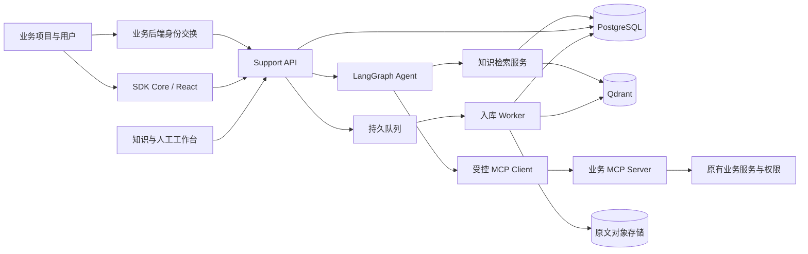

# Leeway Support 智能客服系统技术方案

日期：2026-10-21；状态说明更新于 2026-10-22。本文为目标架构草案，当前已落地基础 Agent、离线测试、多轮流式终端对话和内存 checkpoint，实际实现以 README 和源码为准。本方案依据相邻 agent-practice 的实际示例目录制定，不复制该仓库的教学模拟实现。开发顺序以 agent-development-roadmap.md 为准；每项功能的问题、方案对照、配套实验和验收按 learning-coverage.md 逐项记录。

## 1. 目标、假设与首期边界

建设一个可供多个业务项目接入的客服平台，覆盖知识运营、基于证据的问答、受控业务操作、人工接管和质量评估。默认第一阶段为公司内部多产品使用、小团队维护、中文为主，先支持 Web/React。外部 SaaS、多地区部署、强隔离企业租户及 App SDK 的具体要求待业务确认后扩展。

首个闭环选用一个真实业务项目：用户提问 → 查知识和业务事实 → 生成操作草稿 → 用户确认 → 业务系统执行 → 展示真实状态 → 不满足条件时转人工。可以选择音频处理任务；若选择退款，则先做申请和审批，实际支付退款另行验收。

业务系统是身份、订单、余额、配额、任务及权限的事实来源。客服平台管理会话、知识、编排、接管和审计；模型负责理解、选择受限能力和组织回答，金额计算和业务判断由代码完成。

## 2. 推荐技术栈与部署形态

| 层次 | 推荐 | 选择原因及边界 |
| --- | --- | --- |
| 多包工作区 | pnpm workspace + Turborepo + TypeScript | pnpm 管包和依赖，Turbo 管任务依赖与缓存；不等于微服务拆分 |
| 管理平台 | Next.js + React + 组件库 | 知识管理、检索调试、人工工作台、评估与集成配置 |
| 对外 API | Node.js + Hono + Zod | 身份交换、会话、流事件、审批、SDK 接口与平台权限 |
| Agent | LangGraph JS + LangChain | 显式业务流程节点，局部使用有预算的工具循环 |
| 持久化 | PostgreSQL | 知识元数据、会话控制信息、操作单、接管、审计、LangGraph 检查点 |
| 向量索引 | Qdrant | 稠密/稀疏检索与 payload 过滤；它是可重建索引，不是权限或发布事实源 |
| 异步任务 | Redis + BullMQ | 文档入库、OCR、重建索引、重试及任务状态；正式异步处理阶段引入 |
| 文件 | S3 兼容对象存储 | 原文、解析产物、附件；短时授权上传下载 |
| 集成协议 | MCP，远端使用 Streamable HTTP | Agent 服务做 Client，业务后端做 Server；浏览器不持有业务服务凭证 |
| 观测与评估 | OpenTelemetry + 结构化日志 + 离线评估集 | 可选 LangSmith 辅助调试，评估集与产品指标保留在本项目 |
| 测试 | Vitest + Playwright + 真实服务集成测试 | 区分模拟、数据库/协议、真实模型和业务端到端证据 |

初期部署为管理 Web、API/Agent、Worker 三类进程；Agent 编排先作为 API 引用的内部包，不单独部署一组微服务。数据库、对象存储和队列按环境配置。本地可用 Docker Compose/WSL2。

应用 TypeScript 与 LangGraph CLI 的解析依赖分开管理；参照 agent-practice 的经验验证 schema 提取链，不能把学习仓库锁定版本直接当成本项目的最终依赖组合。先验证 Node、pnpm/Corepack、框架和模型提供商兼容性，再锁定版本。

Turbo 的 dev、真实模型评估、迁移和数据库集成测试禁止使用构建缓存；只有输入/输出明确的静态任务才缓存。禁止把密钥和真实客户数据写入共享缓存。

## 3. 包结构与依赖方向

```text
apps/
  console/               # 管理后台、人工客服工作台
  api/                   # 对外 HTTP/SSE、身份、run 调度
  worker/                # 文档处理、索引任务、持久任务恢复
  integration-demo/      # 模拟业务后端 + MCP Server + SDK 宿主页面
packages/
  contracts/             # Zod schema、错误码、事件和版本
  agent/                 # Graph、节点、策略和中间件
  knowledge/             # 解析、切块、召回、引用、发布服务
  integrations/          # MCP Client、连接注册、凭证解析、授权策略
  database/              # schema、迁移、仓储、检查点配置
  sdk-core/              # 无 UI 会话客户端、事件归并、重连
  sdk-react/             # Provider、hooks、受控卡片与组件
  sdk-server/            # 业务后端会话交换、MCP 工具注册辅助
  ui/                    # 后台与组件通用基础样式
  observability/         # trace、脱敏、指标
  evals/                 # 问答/检索/工具/权限回归集
tooling/
  typescript/            # 共享编译检查配置
  eslint/                # 共享代码规范
docs/
  architecture/          # 业务契约、权限矩阵和 ADR
  learning-map/          # 知识点 -> 业务场景 -> 实现 -> 验收
```

这是一张目标地图，按阶段创建实际需要的包，避免预先生成空壳。apps 通过内部包复用能力，不相互导入源码。SDK 只依赖公开 contracts，不依赖数据库、Agent 或服务端密钥配置。外部业务项目通过发布的版本包接入，不依赖 workspace 源码路径。

## 4. 总体调用链



三类通信分别定义：SDK 到客服平台使用产品 HTTP/流事件接口；Agent 到业务系统使用 MCP；SDK 到宿主界面的动作使用白名单 Host Bridge。MCP 既不是聊天 UI 协议，也不自动解决身份授权。

## 5. 知识库平台与 RAG

### 管理对象

第一阶段支持手工 FAQ、Markdown、文本 PDF、DOCX；扫描 PDF/OCR 和网站抓取按真实资料需求增加。为每个文档保存来源、产品、语言、可见角色、生效范围、负责人、不可变版本和发布记录。

管理页必须有：文档列表和失败原因、解析预览、切块预览、发布/撤回、带过滤条件的检索调试、引用预览、评估对比。上传完成不代表入库成功，入库成功也不代表已发布。

### 入库链路

上传与格式检查 → 对象存储 → 创建不可变文档版本 → 持久任务 → 解析与清洗 → 按标题/段落/表格语义切块 → embedding/可选 sparse 编码 → Qdrant 写入 → 完整性检查 → 待发布 → 审核发布。

切块以结构优先，长度/重叠是待评估参数；记录原文页码、标题路径、定位区间和内容哈希，表格保留表头与行关系。不要把“固定 500 字切块”作为所有文档的统一规则。

### 发布一致性

PostgreSQL 保存发布事实。新版本索引完成并校验后，才在 PostgreSQL 事务中切换产品知识 release 的版本映射，使用 outbox 驱动后续清理/通知。禁止先删旧索引再写新索引。

检索开始固定一个 release；根据其中的已发布文档版本生成过滤条件，召回后再次检查版本及当前权限，再把合格内容送入模型。会话记录使用的 release 与 citations；后续轮次可重新固定最新 release。大规模版本映射再演进为经过验证的 release 索引/collection 切换策略，首期不采用未经验证的跨库“原子事务”。

删除或撤权先在权威元数据中禁止访问，检索服务与原文下载立即遵守；向量清理可异步重试。长会话中已注入的旧知识也要失效/重建上下文；撤权不能只删向量而保留缓存摘要。已有用户收到的内容无法通过删索引收回。

### 在线检索链路

会话身份和产品范围 → 问题改写（必要时）→ 权限/版本前置过滤 → 语义召回 + 关键词/标识符召回 → 排序融合 → 可选 reranker → 当前权限与版本复核 → 证据集合 → 回答与引用。

中文语义问句走 dense embedding；错误码、产品名、版本号、API 字段走关键词或精确字段检索。Qdrant 支持混合检索不等于自动得到高质量中文 BM25：当前官方文档提供 multilingual tokenizer，但默认英文 stemming/stopwords 不宜照搬，FastEmbed 也不支持该 tokenizer 参数。实施时核对所锁定版本及推理链路，或评估中文 sparse 编码器，再以真实问题比较。首期可以 dense + 已知错误码精确匹配建立基线；不要为“支持混合”马上额外部署搜索集群。

候选数量、融合策略、是否 rerank 用离线集比较，不能照搬一个通用相似度阈值。证据不足时澄清、明确缺少依据或转人工。引用由检索产生的候选 ID 白名单映射为真实文档版本和定位，禁止模型自造 URL。答案校验除 citation ID 外，还需抽样验证所引用文本是否支持结论。

订单、余额、会员配额、当前任务状态来自实时业务工具，不写成知识库事实。检索文档和工具返回中的“忽略规则”等文本均按不可信数据处理，不能提升工具权限。

embedding、稀疏模型、分词器、解析器、切块器和 reranker 均记录版本。更换 embedding 模型或维度建立新索引并评估切换，不能把两个不可比较的向量空间混用。

## 6. 向量数据库决策

**默认推荐 Qdrant，关系数据同时使用 PostgreSQL。** 理由是本项目要实践独立知识索引、过滤、混合召回和版本重建，适合明确划分元数据和检索职责，而不是因为它在所有规模下都更快。

| 方案 | 适用情况 | 对本项目的判断 |
| --- | --- | --- |
| PostgreSQL + pgvector | 优先减少服务数量；SQL 联表/事务与权限策略占主导；实测检索质量和时延达标 | 完全可行的简化替代，已有 PostgreSQL 运维能力时尤其合理 |
| Qdrant + PostgreSQL | 知识检索是核心；希望独立调优稠密/稀疏召回、payload 过滤和索引资源 | 本项目默认方案，需要承担两套存储与最终一致性维护 |
| Milvus | 大规模向量业务或团队已有相应基础设施与经验 | 不作为当前空仓库首选，性能与运维收益须压测证明 |
| 托管向量服务 | 愿用费用换运维，部署地区、数据政策和网络条件合适 | 可评估 Qdrant Cloud 等，价格/地区需实施时核对 |

初期同一 embedding 配置的向量可共享 collection，用 tenant/product 等 indexed payload 隔离；权限过滤始终由可信服务生成。强隔离客户可独立 collection/实例，不为每篇文档建 collection，也不允许客户端直连 Qdrant。

没有当前语料、向量维度、QPS、过滤选择性、延迟目标及部署预算，不能给可靠硬件/费用结论，也不能用“超过某个向量数就必须换库”决定。实施前准备 100–200 条真实问题，覆盖同义表达、错误码、跨产品、过期政策、权限隔离和无答案；先固定模型/切块，测召回，再决定是否需要 pgvector 对照实验。

官方研究与协议来源见 docs/research/vector-db-and-mcp.md。其中 release_id 独立索引是可选演进方案；本方案首期采用不可变文档版本 + PostgreSQL release 版本映射过滤，避免每次发布都复制整套向量。两种方案都须保证固定发布快照、查询过滤、发送模型前复核和撤权生效。

### 关系数据核心模型

建议按领域维护 Product/Integration、SupportSession/Conversation/Run、Message/Event、KnowledgeBase/Document/DocumentVersion/Chunk/KnowledgeRelease、Action/Confirmation/ExecutionAttempt、Handoff/Assignment、AuditEvent/EvaluationCase 等实体。

知识发布版本通过关联表绑定多个文档版本；Chunk 的确定性 ID 同时关联 PostgreSQL 来源定位与 Qdrant point。Conversation 的归属、Run 的执行租约、Action 的幂等约束、员工的接管所有权均在权威数据库中管理；LangGraph checkpoint 使用独立表/命名空间，不承担这些业务唯一约束。

## 7. Agent 状态机与职责

主流程建议为：输入校验 → 加载可信会话 → 意图/缺失参数识别 → 知识检索或实时查询 → 生成回答/操作草稿 → 等待确认或人工 → 执行 → 汇报。

明确流程用 LangGraph 节点和条件边；开放诊断步骤才放受限 createAgent 工具循环。固定多步骤不需要为每一步再创建一个 Agent。

State 包含 conversation/run ID、已验证的上下文引用、messages、当前实体 ID、evidence IDs、pendingAction ID、handoff 状态和调用预算。身份原始凭证不进入 state。短期状态用 PostgreSQL checkpointer；会话归属与 run 调度是平台业务表，不能仅靠一个 thread_id 提供访问控制。

长期记忆仅保存用户授权的偏好/人工确认的摘要，并提供删除与过期机制；订单权益等权威事实每次查工具。摘要可能失真，不覆盖审批、动作参数和授权记录。

采用自托管 LangGraph 库 + API 作为第一种运行方式，平台定义版本化事件，sdk-core 处理 HTTP/SSE。学习仓库的 @langchain/react useStream 依赖 LangGraph Server 协议，不能直接指向任意 Hono 路由；若后续选择正式 Agent Server，则单独提供对应 adapter。避免声称一套自定义接口天然兼容两种协议。

## 8. SDK、MCP 与业务授权

### SDK 分层

- sdk-core：创建会话、发消息、订阅事件、重连、取消观察、提交确认；可用于任意前端框架。
- sdk-react：Provider、专用 hooks、消息/引用/任务卡片、待确认表单及人工状态。
- sdk-server：服务端会话交换、签名校验和 MCP 工具注册辅助；业务服务仍实现身份和权限判断。首期可以先给一个 Node 参考适配，不要求其他语言业务安装 Node 包。
- Host Bridge：只提供 open_page、select_entity、fill_draft 等明确动作，严格 schema 和宿主回执；真实退款/任务创建不由浏览器函数授权。

接入过程：管理员登记产品和受信 MCP 端点 → 业务后端持服务端集成凭证交换短时 support session → 浏览器拿仅限产品/用户/会话权限的短时令牌 → SDK 发起聊天 → Agent 使用服务端注册的 MCP 连接和用户授权映射调用工具。匿名用户只允许公开知识问答，登录后需显式认领或新建会话，避免凭浏览器提交 userId 绑定身份。

支持产品 ID 的前端 public key 只用于识别来源，不能代表用户身份。浏览器 pageContext 是提示信息，不能作为用户身份、资源归属或工具权限依据。

### MCP 边界

远端业务能力通过管理员登记的 Streamable HTTP MCP Server 暴露。平台限制受信域名/出站访问、工具名、schema 版本、产品和 scope；新发现工具经审批后才向模型开放。不接受用户消息传入的 MCP URL 或“新增工具”指令。

优先使用符合 MCP 授权规范的 audience 受限授权；无法直接沿用原有业务登录时，建设业务侧身份交换/窄 BFF，不能把原站 Cookie、业务 bearer token 原样透传到不匹配 audience 的服务。平台凭证解析保留在执行上下文，日志和检查点仅留 opaque reference。

MCP 负责发现/调用约定，不替业务系统保证用户权限，也不天然提供副作用幂等和审批。工具列表经过平台过滤后，业务端每次 calls 仍要验证真实用户、资源归属、配额及权限。

### 工具权限矩阵

| 能力 | 模型可选 | 用户确认 | 执行侧约束 |
| --- | --- | --- | --- |
| search_knowledge | 是 | 无需 | 可信产品/租户/角色/发布范围 |
| get_order/get_task/get_quota | 是 | 通常无需 | 当前用户与资源归属、最小化返回字段 |
| prepare_action | 是 | 尚未执行 | 业务计算有效参数、风险和预计消耗 |
| execute_action | 经过策略控制 | 涉及费用/副作用须确认 | 审批绑定、参数哈希、有效期、重新鉴权、幂等 |
| 高风险退款/权限修改 | 首期不给自主执行 | 按业务规则人工审批 | 人工操作仍由业务系统鉴权 |
| open_page/fill_draft | 是 | 按界面动作约定 | 宿主白名单、schema、回执，不当成写入成功 |

### prepare/confirm/execute

prepare 返回 actionId、规范化参数摘要、预计消耗、expiresAt 和 confirmationRequired。用户通过卡片提交确认；API 验证 actor、会话、actionId、参数版本与有效期，保存确认记录，再恢复 graph。不能把模型说“用户已经同意”作为确认凭证。

execute 从 actionId 加载已保存的参数，业务系统重新校验资格和状态，并以持久幂等键执行。确认后参数变化或凭证过期必须重新 prepare。幂等记录与业务写入尽可能在业务侧同一事务/可靠状态机中保证，不能只使用 Redis 临时锁。

MCP 调用超时可能意味着“执行了但响应丢失”，此时查询 action 状态/对账，不能直接重试副作用。长任务返回 taskId，由任务事件、webhook 或受控后台查询更新进度，模型不持续轮询。

建议错误码包括 UNAUTHENTICATED、FORBIDDEN、RESOURCE_NOT_FOUND、VALIDATION_ERROR、QUOTA_EXCEEDED、ACTION_EXPIRED、CONFLICT、UPSTREAM_TIMEOUT、EXECUTION_UNKNOWN。结果区分可重试、待确认、可人工处理，模型只负责解释这些真实状态。

## 9. 流事件、并发与人工接管

平台接口草案：POST /v1/sessions（服务端交换）、POST /v1/conversations、POST /v1/conversations/:id/messages、GET /v1/runs/:id/events、POST /v1/actions/:id/confirm、POST /v1/conversations/:id/handoff。所有路径均需归属检查，实际接口在实现阶段细化。

流事件 envelope 使用 protocolVersion、conversationId、runId、eventId、sequence、type、payload。事件类型包括 message.delta、citation、tool.started/completed、action.required、handoff.changed、run.completed/failed。保存足够的事件/快照供重连，定义保留期和超出保留期的快照恢复；客户端按 eventId 去重。

同一会话最多一个有执行权的 run，后续消息明确排队/拒绝/取消后续续跑；用持久 run 状态、数据库租约与 fencing/version 检查防止并发写 checkpoint 和动作。客户端断开观察不等于取消 run，取消 run 也不等于撤销已提交的业务任务。

人工接管状态建议为 bot → waiting_human → human → resolved；员工基于角色认领，转移及释放记录审计。接管时禁止启动新的机器人回复或动作，失效未消费的机器人审批；已发出的业务动作按真实状态核对，不能假装撤销。

interrupt/resume 只是暂停/恢复机制；还需要人工队列、员工角色、接管所有权、超时、通知和交还机器人规则。resume 节点可能重跑，副作用必须隔离到可安全恢复的执行节点。历史分叉/time travel 默认只在调试环境或只读重放使用，不能再次执行真实写操作。

## 10. 学习点到业务场景的完整映射

| agent-practice 学习点 | 在本项目解决的问题 | 引入时机与验收 |
| --- | --- | --- |
| model.ts、shared/model、模型接入说明 | 统一模型网关，兼容模型接口和工具调用 | 首期；真实供应商验证流、schema、工具及超时 |
| beginner.ts / createAgent / tool | 订单或任务只读查询工具循环 | 首期；参数校验且结果来自真实接口 |
| structured-output.ts、structured-output | 意图、操作草稿、引用与业务卡片 | 首期；Zod 校验失败可恢复，无任意 HTML |
| command-update.ts、remember.ts | 将当前订单/任务 ID 写入短期 state | 首期；每次使用仍做归属校验 |
| memory.ts | 跨轮次/重启继续会话 | 首期；用持久检查点验证重启后恢复 |
| middleware.ts | 模型前后日志、工具策略和错误转换 | 首期；跨产品/越权调用在执行前拒绝 |
| model-call-limit、tool-call-limit | 控制循环、成本与滥用 | 首期；达到预算明确结束/交接 |
| pii-middleware | 输入、工具返回、输出及观测脱敏 | 首期；多层处理，不能只依赖模型消息中间件 |
| fallback-middleware | 主模型故障切换 | 稳定性阶段；备选模型满足工具/schema契约，流中途失败新建可追踪尝试 |
| summarization-middleware | 长会话压缩 | 第二阶段；不丢审批、授权、关键实体和引用版本 |
| context-editing-middleware | 削减庞大的历史工具结果 | 第二阶段；原始证据另存，当前任务必需事实不删除 |
| llm-tool-selector | 工具增加后减少候选 | 工具选择评估出现问题时；权限过滤先于模型筛选 |
| provider-tool-search | 提供商侧按需发现工具 | 可选实验；和上一种方法对照，验证提供商与MCP工具兼容性，不强制同时用 |
| tool-emulator | 业务尚未就绪时演示工具效果 | 仅演示；正式回归用可重复 fixture/契约测试，不能拿模拟结果验收业务 |
| basic-chat / useStream | 基础流消息与状态理解 | 首期；sdk-core 重现产品所需能力；useStream 只用于兼容 Agent Server 的 adapter |
| ai-elements | 消息展示、输入与流状态映射 | 首期可选 UI 基础；前端不绑定某个后端私有 state |
| hitl | 补充信息、用户确认和人工审批 | 首个写工具之前；伪造/重复/过期确认失败 |
| message-queues | 连续发消息、同会话顺序执行 | 首期；多 API 实例下仍不重复执行 |
| join-rejoin | 刷新/断网后继续观察 | 首期；不丢结果、不重复工具、副作用不随观察连接重启 |
| branching | 编辑问题/重新生成回答 | 只读链路成熟后；旧动作不能在新分支重执行 |
| time-travel | 错误定位、检查点对比、离线回放 | 调试阶段；审计访问控制，重放禁写 |
| generative-ui | 订单、任务、确认等白名单卡片 | 首期；组件和参数受控，不执行模型 JS |
| CopilotKit 页面上下文/前端工具 | 业务页面联动与填草稿 | 第二阶段可选 React adapter；不再造第二个主运行时，不直接改真实业务数据 |
| OpenUI / progressive DSL | 人工工作台客服质量报表 | 运营报表需求出现时；DSL、组件、数据源与权限白名单 |
| subagent.ts、subagent-middleware | 订单诊断/技术故障知识域隔离 | 工具与上下文复杂度实测需要时；子 Agent 继承权限和总预算 |
| openui/parallel、Deep Agents | 独立只读报表面板/复杂排障分解 | 实验后评估；并行只读任务结果可追踪，不并行真实退款 |
| todo-list-middleware | 复杂诊断的步骤可视化 | 复杂场景引入；清单只是规划，完成状态需真实执行证据 |
| filesystem-middleware | 离线解析或受控诊断文件 | 隔离 Worker/沙箱实验；在线客服不开放任意 shell、主机文件或 execute |
| 检索策略.md | 语义检索与关键词/精确标识符结合 | RAG 阶段；引用其中思路需本项目真实评估，不能照搬未核实性能数字 |

“全部知识点用到”定义为全部进入学习映射，落到真实需求或隔离实验，并记录取舍；不等于在同一用户请求中堆叠全部框架。每个业务场景 README 固定记录：问题、输入、处理流程、输出、为何选此方案、替代方案、失败模式和验收证据。

## 11. 必须补齐的生产能力

- 产品/租户/角色隔离：所有查询、后台操作、任务和下载统一授权；不能只在向量检索加过滤。
- 数据生命周期：客户内容脱敏、日志保留期、文档撤回、会话删除、检查点/摘要/备份的删除策略。
- 检索质量：中文分词、解析错误、来源版本、冲突证据、无答案与恶意文档测试。
- 工具可靠性：schema 变更检测、超时状态核对、幂等、重试分类、熔断、审批失效和任务恢复。
- 可观测性：贯通 conversation/run/tool/action/trace ID；记录阶段延迟、费用、错误与版本，不记录原始凭证和隐藏推理。
- 人工闭环：排队、认领、处理记录、交还、通知与 SLA；不能把模型回复“已转人工”作为接管成功。
- 持续评估：检索、回答、工具选择、执行授权、恢复分别验收；人工满意度与业务完成率独立统计。

## 12. 实施顺序与验收门槛

| 阶段 | 交付 | 必须通过的门槛 |
| --- | --- | --- |
| P0 契约与骨架 | 场景、权限矩阵、身份交换、工具/事件 schema、工作区和演示业务 | 无真实客户凭证；模拟与真实模式明确区分；工具链和 schema 校验通过 |
| P1 知识问答闭环 | FAQ/文档入库、Qdrant、发布撤回、引用、SDK 流式聊天 | 无答案不编造；跨产品与未发布文档不泄露；重启/重连可恢复 |
| P2 单业务工具闭环 | 1 个读工具 + 1 个 prepare/execute 工具、确认卡片、任务状态 | 越权/过期/重复确认拒绝；重复执行不重复扣费；执行未知可核对 |
| P3 人工与稳定性 | 接管队列、恢复/重试、限流预算、观测和回归 | 人工接管期间机器人不能新增执行；崩溃恢复与断流不重复副作用 |
| P4 按需进阶 | 分支回放、子 Agent、工具发现、CopilotKit/OpenUI/文件沙箱实验 | 与基线比较质量、延迟、成本和维护量，只推广有收益的方案 |

P1/P2 的先后可按首个业务场景调整，但涉及真实写操作必须先完成身份、审批和幂等契约。首期从“一个产品、一个知识库、一个业务动作”验收，不先铺多个业务连接器。

离线集建议 100–200 条起步，不足以代表所有真实流量；每类明确预期证据、预期工具及不允许发生的动作。硬门槛包括已定义测试集中的权限隔离和幂等用例全部通过；Recall@k、引用正确率、回答依据、p95 延迟及单次成功解决成本以真实基线商定，不写未经验证的 SLA。

最终业务验收必须由目标业务环境完成：真实用户身份、真实服务端授权、真实 MCP 调用、真实任务/订单状态以及可追踪审计。静态检查、模拟模型或本地卡片展示不能替代这一层验收。

## 13. 参考资料

- Turborepo 工作区结构：https://turborepo.dev/docs/crafting-your-repository/structuring-a-repository
- LangGraph 持久化：https://docs.langchain.com/oss/javascript/langgraph/persistence
- LangGraph interrupt/resume：https://docs.langchain.com/oss/javascript/langgraph/interrupts
- 向量库与 MCP 官方资料及选型细节：./research/vector-db-and-mcp.md

本文为技术方案，不代表已完成 SDK、Agent、知识库或业务接入验证。外部服务的版本、价格、地区和供应商模型能力在实施阶段重新核对。
